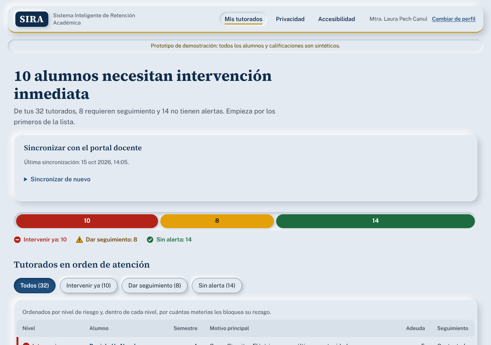
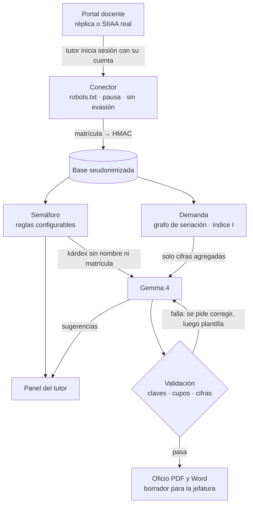
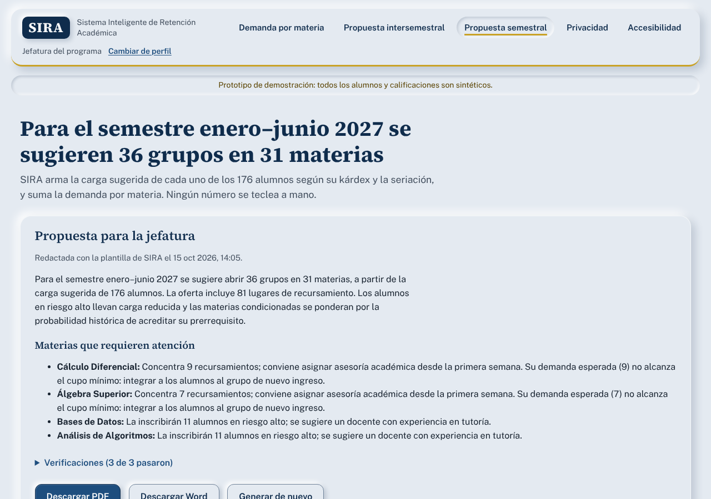

# SIRA · Sistema Inteligente de Retención Académica

SIRA lee los kárdex de los tutorados desde el portal docente. Con esos datos le avisa al tutor quién necesita intervención y calcula la demanda real de cada materia. Al final, Gemma 4 redacta la propuesta de oferta intersemestral y SIRA verifica cada cifra antes de emitir el borrador del oficio.

> **Prototipo de demostración.** Todos los alumnos, matrículas y calificaciones de la demo son sintéticos. La demo usa una réplica del portal docente incluida en la app, así que nadie necesita credenciales reales para probarla.



## El problema

| Hoy | Con SIRA |
| --- | --- |
| El tutor revisa kárdex por kárdex para saber quién va mal | Un clic sincroniza a sus tutorados y el semáforo los ordena por urgencia |
| La gestión pregunta con encuestas qué materias se necesitan | La demanda se calcula con los kárdex reales, ponderada por seriación y riesgo |
| La oferta intersemestral se decide y redacta a mano | Gemma 4 redacta la propuesta y SIRA la valida contra los datos antes del oficio |
| Los grupos del siguiente semestre se estiman con la experiencia de periodos anteriores | SIRA arma la carga sugerida de cada alumno y suma la demanda real por materia |

## Prueba la demo en 3 minutos

1. Abre la app y entra como **tutor** (Mtra. Laura Pech Canul).
2. Escribe la contraseña de la réplica (`demo2026`) y pulsa **Sincronizar mis tutorados**. Verás al conector recorrer el listado y cada kárdex.
3. Revisa el semáforo y abre a un alumno en rojo. Ahí están el motivo en lenguaje llano, sus materias adeudadas y una sugerencia de intervención. También puedes registrar el seguimiento.
4. Pulsa **Cambiar de perfil** y entra como **jefatura**. Pulsa **Simular que todos los tutores sincronizan** y revisa el ranking de demanda. Puedes mover los pesos β y γ.
5. Pulsa **Generar propuesta intersemestral**. Revisa las verificaciones, descarga el oficio en PDF o Word y pulsa **Probar con una cifra inventada** para ver cómo la validación la rechaza.
6. Abre **Propuesta semestral**, pulsa **Generar propuesta semestral** y revisa los grupos sugeridos por materia para el semestre enero–junio 2027.
7. Abre **Privacidad** para ver el JSON exacto que recibe Gemma.

Como tutor, en el detalle de cada alumno también verás su **carga sugerida** para el próximo semestre.

## Cómo funciona



### 1. Recolección: scraping ético
El conector (`app/conector.py`) hace lo mismo que el tutor haría a mano: inicia sesión con **su** cuenta, abre **su** listado de tutorados y consulta cada kárdex.
- Usa la contraseña solo durante la sesión y nunca la guarda.
- Respeta `robots.txt`, espera entre páginas (`SCRAPER_PAUSA_S`) y se identifica con su propio User-Agent.
- Si el portal pide un CAPTCHA o responde 403 o 429, **se detiene**. Nunca intenta evadirlo.
- Los selectores del portal viven en `config/siiaa_selectores.json`. Si el portal cambia su HTML y los selectores fallan, Gemma 4 interpreta la tabla, después de quitarle el bloque con nombre y matrícula.

### 2. Semáforo del tutor
Las reglas son explícitas y configurables en `config/reglas.json`:

| Nivel | Regla de demostración |
| --- | --- |
| Intervenir ya (octágono) | Materia en última oportunidad, 3 o más materias adeudadas, o una adeudada que bloquea 12 o más materias de la retícula |
| Dar seguimiento (triángulo) | 1 o 2 materias adeudadas, o una caída del promedio de 1 punto o más |
| Sin alerta (círculo) | Sin adeudos y con avance regular |

### 3. Demanda por materia
La seriación se modela como un grafo dirigido con networkx. El ranking usa este índice:

**I = D × (1 + β·B) × (1 + γ·U/D)**

donde D son los alumnos que adeudan la materia, B las materias posteriores que bloquea y U los alumnos en riesgo alto. La demanda total suma a quienes la cursan hoy y probablemente la reprueben, según la tasa histórica de los últimos 3 periodos. El panel muestra cuántos tutores han sincronizado, para que nadie lea una muestra parcial como si fuera el total.

### 4. Propuesta con Gemma 4 y validación
- Modelos: `gemma-4-26b-a4b-it` para sugerencias y extracción, y `gemma-4-31b-it` para la propuesta, vía Gemini API (Google AI Studio). La salida es JSON con esquema.
- **Los números los calcula el código; Gemma argumenta.** Antes de emitir el oficio, SIRA verifica 7 cosas: la estructura, que las claves existan, que no haya repetidas, el cupo mínimo, los grupos disponibles, que los cupos coincidan con la base y que cada cifra del texto aparezca en los datos.
- Si Gemma no pasa la validación, SIRA le devuelve los errores para que corrija. Si vuelve a fallar, o si no hay API key, usa una plantilla determinista. El oficio siempre dice qué camino se tomó.

### 5. Propuesta semestral
Para cada alumno, SIRA arma la carga sugerida del próximo semestre:
1. Primero, las materias que adeuda y no cursa hoy, empezando por las que están en su última oportunidad.
2. Después, las materias nuevas cuya seriación ya cumple, de los semestres más bajos primero y priorizando las que destraban más materias.
3. Respeta un límite de 6 materias y 46 créditos. Los alumnos en riesgo alto llevan como máximo 4 materias.

La oferta suma esas cargas por materia. Hay dos tipos de alumnos: los **seguros** ya cumplen la seriación, y los **condicionados** dependen de acreditar algo que cursan hoy, así que cuentan según la tasa histórica de aprobación de ese prerrequisito. Con esa demanda esperada se calculan los grupos (cupo de 10 a 35). Las materias sin cupo reciben una recomendación concreta, por ejemplo integrar a los alumnos al grupo de nuevo ingreso.

Gemma 4 redacta el resumen y las observaciones para la jefatura, y SIRA aplica la misma validación de cifras que en la propuesta intersemestral. Los límites están en `config/reglas.json`, en la sección `semestral`.



## Diseño de la interfaz
La interfaz usa **neumorfismo institucional**: superficies del mismo tono que el fondo, en relieve o hundidas, con la paleta azul laguna y oro. El oficio se muestra como una hoja de papel blanco sobre ese fondo. El estilo no sacrifica accesibilidad:
- todo el texto mantiene contraste AA sobre el fondo (6.8:1 el texto secundario);
- cada control tiene un borde visible de 3.3:1, no solo sombra;
- el estado activo se marca con color, subrayado o texto, no solo con relieve;
- en modo de alto contraste del sistema, las sombras se reemplazan por bordes sólidos.

## Ejecutarlo

```bash
git clone <este repositorio> && cd sira
python -m venv .venv && source .venv/bin/activate
pip install -r requirements.txt
cp .env.example .env        # agrega tu GEMINI_API_KEY (opcional)
uvicorn app.main:app --port 8000
```
Abre http://127.0.0.1:8000. Sin `GEMINI_API_KEY`, todo funciona con las plantillas de respaldo, y el pie de página indica en qué modo estás.

**Docker:** `docker build -t sira . && docker run -p 8000:8000 -e GEMINI_API_KEY=... sira`

**Render:** el repositorio incluye `render.yaml`. Crea un servicio desde el repositorio y agrega `GEMINI_API_KEY` como variable secreta.

### Conectar con el portal real
El prototipo cuenta con autorización para usarse con la Intranet Docentes (SIIAA) de la UNACAR. Para conectarlo:
1. Guarda las páginas del listado de tutorados y de un kárdex con «Guardar como → solo HTML», reemplaza nombres y matrículas por datos inventados y ajusta `config/siiaa_selectores.json`.
2. Define `SIIAA_BASE_URL=https://charal.unacar.mx/intra_docente` y `SCRAPER_PAUSA_S=2.5`.
3. Ejecútalo **solo en la computadora del tutor**. Los datos reales nunca deben subirse al repositorio ni al despliegue público.

## Privacidad
- La matrícula se convierte en seudónimo con HMAC-SHA256 antes de guardarse (`SIRA_SECRET`).
- El nombre y la matrícula viven en una tabla aparte que solo usa la pantalla del tutor. Ninguna consulta que alimenta a Gemma la lee, y una prueba automática lo verifica.
- Las notas de seguimiento del tutor nunca salen de SIRA.
- Antes de un piloto con datos reales: revisen los términos del plan de la API sobre el uso de entradas, o ejecuten Gemma 4 en un servidor institucional. Es un modelo abierto con licencia Apache 2.0 y el prompt no cambia.

## Accesibilidad: cómo la probamos
| Página | Fallas de axe-core (WCAG 2.2 A/AA) | Desplazamiento horizontal a 320 px | Foco visible con Tab |
| --- | --- | --- | --- |
| Inicio, panel del tutor, detalle de alumno, demanda, propuesta intersemestral, propuesta semestral, privacidad, accesibilidad | 0 en las 8 páginas | Ninguno | Sí |

Puedes repetir la auditoría con `python tests/accesibilidad.py` (necesita `pip install -r requirements-dev.txt && python -m playwright install chromium`). Los resultados se publican en la página `/accesibilidad`.

- El semáforo nunca depende solo del color: combina forma, icono y texto ([captura en escala de grises](docs/capturas/panel-tutor-escala-grises.png)).
- Tiene enlace «Saltar al contenido», regiones con nombre, tablas con encabezados reales y el progreso de sincronización anunciado al lector de pantalla.
- Es usable en móvil ([captura](docs/capturas/detalle-alumno-movil.png)), respeta «reducir movimiento» y el modo de alto contraste.
- **Pendiente:** una prueba con tutores reales, incluida una persona usuaria de lector de pantalla, y el etiquetado PDF/UA del oficio.

## Pruebas
```bash
pip install -r requirements-dev.txt
pytest -q
```
Las 19 pruebas cubren el flujo completo de punta a punta: login incorrecto, CAPTCHA, seudonimización, reglas del semáforo, índice de impacto, que Gemma no reciba datos personales, rechazo de cifras y claves inventadas, corrección de Gemma tras un rechazo (simulada), extracción con Gemma cuando cambian los selectores, carga semestral que respeta seriación y límites, coherencia de la oferta semestral y oficios en PDF y Word.

## Estructura
```
app/
  conector.py          scraping ético + seudonimización
  siiaa_replica.py     réplica del portal docente (datos sintéticos)
  datos_sinteticos.py  generador de kárdex ficticios
  motor.py             semáforo, grafo de seriación, demanda, carga y oferta semestral
  gemma.py             cliente de Gemma 4 (extracción, sugerencias, propuesta)
  propuesta.py         propuesta intersemestral: validación y plantilla de respaldo
  semestral.py         propuesta semestral: redacción con Gemma y validación
  oficio.py            oficio en PDF y Word
  templates/, static/  interfaz accesible
config/                reglas, retícula y selectores del portal
tests/                 pruebas y auditoría de accesibilidad
```

## Historia del proyecto
**Meta.** Que ningún alumno llegue a su última oportunidad sin que su tutor lo sepa, y que la oferta intersemestral se decida con datos y no con encuestas.

**Valor único.**
- Cierra el ciclo completo: del kárdex del tutor al oficio de la jefatura, en un solo flujo.
- La demanda no se mide solo por reprobación: pondera cuántas materias destraba cada una por seriación y cuántos alumnos en riesgo alto la necesitan.
- La IA trabaja sin ver datos personales y nunca puede inventar una cifra en el oficio, porque cada número se valida contra la base.

**Plan después del evento.**
1. Piloto en un programa educativo con autorización de Servicios Escolares, empezando con los tutores voluntarios.
2. Sustituir el scraping por una exportación oficial o una API del SIIAA cuando esté disponible. El resto del sistema no cambia.
3. Medir horas de revisión ahorradas por tutor y porcentaje de alumnos en rojo contactados a tiempo.
4. Ejecutar Gemma 4 en infraestructura de la institución.

## Equipo
| Integrante | Correo |
| --- | --- |
| _Nombre_ | _correo@ejemplo.com_ |
| _Nombre_ | _correo@ejemplo.com_ |

**Nombre del equipo:** _por definir_

## Licencia
MIT. Ver [LICENSE](LICENSE). Las fuentes tipográficas Public Sans y Source Serif 4 se distribuyen con licencia SIL OFL (`app/static/fuentes`), y axe-core, usado solo en pruebas, con licencia MPL 2.0 (`tests/vendor`).
